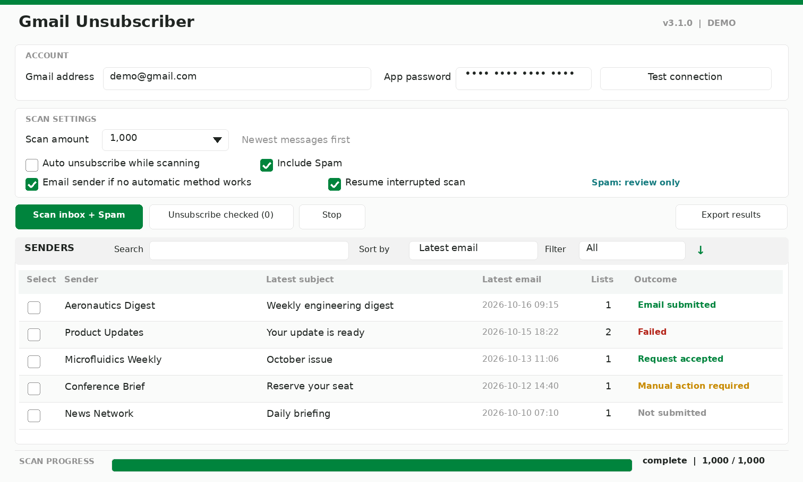
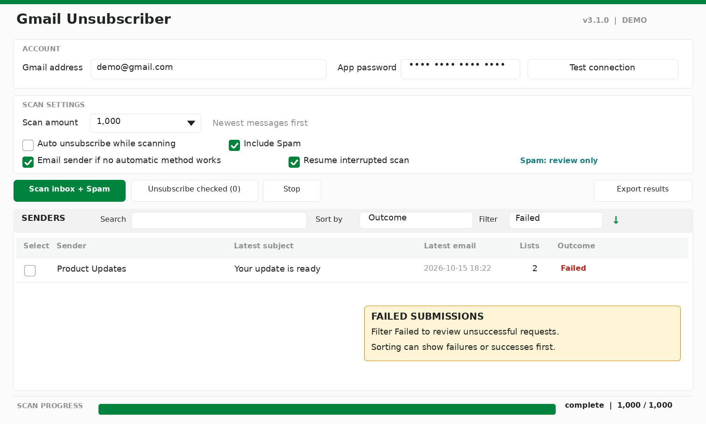
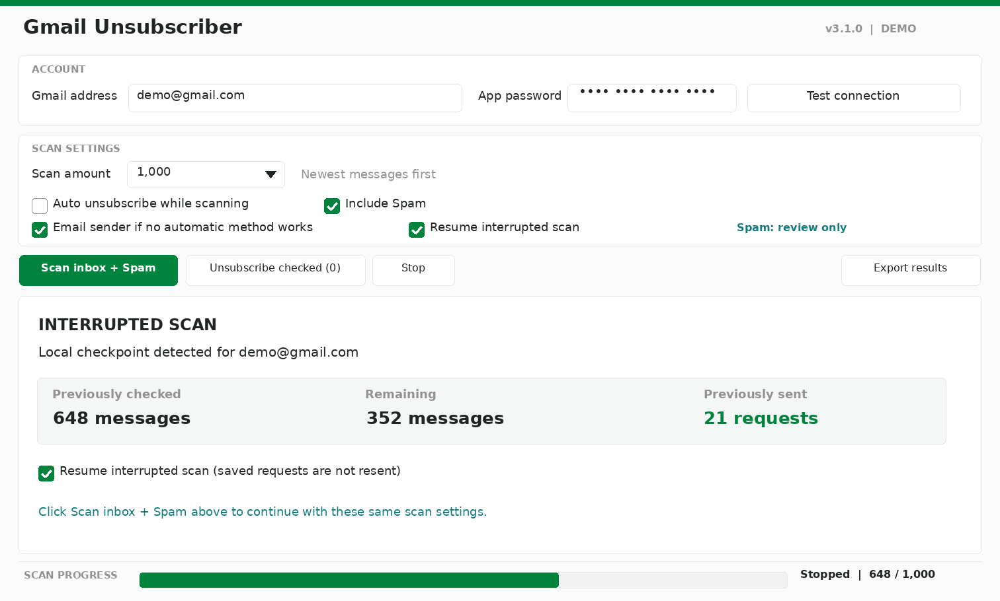

# Gmail Unsubscriber

**Version 3.1.0**

I built Gmail Unsubscriber to scan mailing lists, review their unsubscribe options, and submit unsubscribe requests without having to open each email. It works with Gmail through read-only IMAP and sends supported unsubscribe requests through HTTPS or authenticated SMTP.

This release adds Spam scanning, optional sender-directed unsubscribe request emails, interruption recovery, and sorting by outcome.



*Sample-data interface preview for v3.1.0. No real email addresses or Gmail connections were used. Run `capture_readme.py` after installation to replace these previews with screenshots captured from the application.*

<details>
<summary>Additional interface previews</summary>

### Find unsuccessful requests



Filter the sender list by **Successful**, **Failed**, **Needs attention**, or **Pending**, or sort all visible senders by **Outcome**. Sorting and filtering do not change which senders have been checked.

### Resume a partial scan



The local checkpoint records which mailbox messages were checked and which request outcomes were already submitted. An interrupted scan can continue after the program closes or the machine restarts.

</details>

## Features

- **INBOX and Spam.** Scan the inbox alone or enable **Include Spam**. Spam is reviewed separately and is never automatically sent unsubscribe requests. To act on a Spam result, run in scan-only mode, inspect the sender, and select it manually. Archived mail and Trash are excluded.
- **Opt-in request email.** Enable **Email sender if no automatic unsubscribe works** to request removal from a syntactically valid sender address on an identifiable mailing-list message when no usable `mailto:` header is provided. The app checks for list identification through `List-ID` or `Precedence: list/bulk`. It does not send this fallback for Spam, ordinary personal messages, or common no-reply addresses. This is a plain SMTP email, not proof of list removal.
- **Auto unsubscribe or review first.** Auto mode sends supported requests as they are discovered in INBOX. Scan-only mode lets me check individual senders before taking action. The fallback email setting is separate from auto mode.
- **Resume scanning.** With **Resume interrupted scan** checked, the app uses a private local SQLite checkpoint to restore progress after Stop, a crash, or a restart. Checkpoints are specific to the account, scan amount, mode, and selected folders. Saved mailbox UID and UIDVALIDITY information protects against accidentally processing the wrong message after Gmail reorganizes a folder.
- **No duplicate deliveries.** Requests are reserved in the local history before any network submission. Accepted and uncertain attempts are never automatically resent on a later run. If a process shuts down during submission, that request remains **Outcome unknown** rather than being automatically retried.
- **Sortable results.** Search by sender, subject, or list ID. Sort by sender, subject, latest email, or outcome. Filter for successful, failed, needs-attention, or pending entries.
- **Visible progress and exports.** The progress bar shows checked messages and the run state. Export request outcomes to CSV for further review.

## Requirements

- Python **3.10 or newer** with Tkinter
- A Gmail account with IMAP enabled where applicable
- A Google **app password**, not the regular account password
- Dependencies from `requirements.txt`
- A working connection to Gmail IMAP and SMTP to scan or send requests

Windows launchers are included. On Linux, install the requirements and launch the Python application with a desktop display.

## Installation

### Download or clone

```sh
git clone https://github.com/HaytamElbouhmidi/gmail-unsubscriber.git
cd gmail-unsubscriber
python -m pip install -r requirements.txt
```

On Windows, use `Gmail Unsubscriber (Standard Mode).pyw`, `Gmail Unsubscriber.pyw`, or the supplied `.cmd` launcher. Administrator access is not required to contact Gmail.

On Linux, use:

```sh
python gmail_unsubscriber.py
```

### Updating from 3.0

If you downloaded the **3.1.0 update package** separately, extract its contents **directly into the repository root** so the new `scan_history.py`, `patch_parts` directory, `README-v3.1.md`, and documentation images are alongside the existing files. The updater installs the revised `README.md` after the source passes its checks.

```sh
python upgrade_v3_1_0.py
python -m unittest discover -v
```

The updater verifies the original `gmail_unsubscriber.py` revision, creates `gmail_unsubscriber.py.v3.0.backup`, and syntax-checks the result before replacing the source. It stops without changing the source if the installed version does not match. A backup is local only and should not be committed. The update doesn't need a new Gmail password.

Once an updated full release contains version 3.1.0, the updater is not needed again.

## Using the application

1. Enter the Gmail address and app password.
2. Choose a scan amount: **250**, **500**, **1,000**, **Custom**, or **Entire inbox**. When Spam is enabled and a limited count is selected, the app divides the count between INBOX and Spam, using any unused capacity from the other folder. **Entire inbox** with Spam enabled scans every message in both selected folders.
3. Turn on **Include Spam** to review messages from that folder. Leave it off for INBOX-only scanning.
4. Optionally check **Email sender if no automatic unsubscribe works**. The confirmation explains that direct emails can reveal an active mailbox address.
5. Leave **Resume interrupted scan** checked if you want a partial scan to continue after restarting the program. Resume is the default.
6. Leave **Auto unsubscribe while scanning** off to review first, then click **Scan inbox** or **Scan inbox + Spam**. Check senders and use **Unsubscribe checked** to process their distinct mailing lists. Auto mode is off by default.
7. If automatic mode is enabled, click **Scan + auto unsubscribe**. Supported INBOX requests are submitted as lists are found. Spam results remain review-only.

The progress bar counts the messages actually examined. After completion it displays **Complete**. A stopped or failed scan retains partial progress and displays **Stopped** or **Error**. Completing a scan does not mean every list has removed the address.

**Stop** cancels further work but cannot recall requests already sent. Launch the program again using the same account and scan settings to resume the saved job.

### Results and sorting

Every sender row includes its latest scanned subject, date, number of distinct lists, and current outcome. The search bar works locally, including against older scanned subjects. The direction button reverses the sort order. Selecting a row is not the same as checking its box.

Use the **Outcome** filter for these views:

| Filter | Meaning |
| --- | --- |
| Successful | An HTTPS request was accepted or SMTP accepted an email, including entries already submitted |
| Failed | Request failed or was blocked |
| Needs attention | An uncertain outcome, mixed results, or manual action required |
| Pending | Not yet submitted or still being processed |

An accepted request is **not independently confirmed** removal from the sender's mailing list. The details tab preserves the method-level results for each discovered list. Different results for one sender show mixed outcomes instead of a misleading all-successful state.

## How unsubscribe requests work

The app first looks for `List-Unsubscribe` headers. Valid one-click HTTPS POST requests require DKIM verification of the message. A `mailto:` unsubscribe header can send its prescribed email. An ordinary web link that needs confirmation is marked **Manual action required**, since the app does not complete web forms or scrape message bodies.

When the **plain request email** option is selected, the app can send a short removal request to the mailing-list sender if the existing automated methods cannot finish and there is no supported `mailto:` target. It only enables this fallback for identifiable list messages in INBOX. It will not send that request to Spam senders. A sender may ignore any of these methods, including the plain email.

## Scan history and privacy

The application keeps a local SQLite database in:

| Operating system | Location |
| --- | --- |
| Windows | `%LOCALAPPDATA%\gmail-unsubscriber\progress.sqlite3` |
| Linux | `${XDG_STATE_HOME:-~/.local/state}/gmail-unsubscriber/progress.sqlite3` |

This database stores per-account scan options, folder UIDs, header metadata, unsubscribe targets, results, and a durable send ledger. It does **not** store Gmail credentials or message bodies. File permissions restrict access on Unix-like systems, but the database itself is **not encrypted**. It can contain personal sender information and private unsubscribe tokens. Do not upload it or add it to GitHub.

If a request might have been sent when the program stopped, its durable status remains uncertain. The app avoids automatic retries rather than risking a duplicate message. To rescan from the beginning, uncheck **Resume interrupted scan**, but previously accepted and uncertain submissions remain protected by the delivery ledger.

To discard private state entirely, close the program first and remove the `progress.sqlite3` file manually. This also removes protection against resending previously attempted requests. Only clear it when you intend to reset that history.

The app does not move, delete, archive, or mark messages as read. CSV exports contain sender information and sometimes unsubscribe tokens, so treat them as private files.

## Screenshots

The included v3.1.0 previews use synthetic email records to avoid exposing personal data. To regenerate them from the **actual running Tkinter interface** after installing 3.1.0, install Pillow in your development environment and run:

```sh
python -m pip install pillow
python capture_readme.py
```

On a headless Linux computer with Xvfb:

```sh
xvfb-run -a python capture_readme.py
```

This script opens the actual interface, inserts mock entries locally, and replaces the three v3.1.0 images. It never logs in, scans Gmail, or sends email.

## Troubleshooting and tests

**Test connection** checks connectivity without authenticating a Gmail address. For scan errors, inspect the Activity log. The IMAP reader retries bounded mailbox failures and stops after repeated unsuccessful fetches to avoid silently skipping thousands of messages.

To run the tests without a GUI:

```sh
python -m unittest discover -v
```

On Linux with a virtual display:

```sh
xvfb-run -a python -m unittest discover -v
```

Tests use mock mailboxes, mock submissions, and synthetic headers. A passing offline suite does not prove that a specific Gmail account or sender will accept a live unsubscribe request.

## Support

Support my work through [Ko-fi](https://ko-fi.com/haytamelbouhmidi) or [Patreon](https://www.patreon.com/c/HaytamElbouhmidi).

## License

MIT. See [LICENSE](LICENSE).
