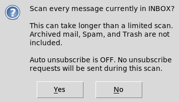

# Gmail Unsubscriber

Scan your Gmail inbox, find mailing lists, and unsubscribe from the senders you choose. Or turn on auto unsubscribe to send requests while it scans.


*Sample inbox data. Captured from the app on Linux; Windows styling may differ.*

<details>
<summary>More screenshots</summary>

### Scan amount

Choose a preset, enter a custom count, or scan the entire inbox.


### Auto unsubscribe

Turn it on to send requests while scanning. Here it's set to a custom count of 2,500 messages.


### Search and sort

Results filter as you type. Sort by sender, subject, or latest email. Checked senders stay checked even when a search hides them.


### Entire-inbox confirmation

This appears when you start an entire-inbox scan, not a limited scan.



### Scan progress

The counter updates during the scan, including messages without unsubscribe links.


The bar stays full when the run finishes. Complete means the run finished, not that every unsubscribe request succeeded.


</details>

## Setup

You'll need Python 3.10 or newer with Tkinter and a Google app password. Your regular Gmail password won't work.

1. Download the ZIP and extract it. Keep the files together.
2. Double-click `Gmail Unsubscriber.pyw`.
3. Allow dependency installation if prompted.

The default launcher requests administrator access. Gmail doesn't need it, so `Gmail Unsubscriber (Standard Mode).pyw` is also included. If double-clicking opens an editor, use `Start Gmail Unsubscriber.cmd`.

Upgrading from the previous Auto Unsubscribe version? Close the app and replace `gmail_unsubscriber.py`. The launchers and dependencies haven't changed.

## Use it

Enter your Gmail address and app password. The **Google app passwords** button opens the account page.

Set **Scan amount** to **250**, **500**, **1,000**, **Custom**, or **Entire inbox**. Enter custom counts in the field beside the dropdown. Start uses this setting directly. Only an entire-inbox scan asks for confirmation, once when you press Start.

**Auto unsubscribe is off by default.** Click **Scan inbox**, check the boxes beside the senders you want to remove, then click **Unsubscribe checked**. Checkboxes can be set while scanning; sending is enabled after the scan finishes or stops. Highlighting a row does not check it.

With **Auto unsubscribe while scanning** turned on, click **Scan + auto unsubscribe**. Supported requests are sent immediately, including unsubscribe emails from your account. There's no per-sender approval in this mode.

The progress bar shows how many messages have been checked and the percentage done. The status line shows the current step and elapsed time, including time spent waiting for Gmail. When the run finishes, the bar stays full and shows **Complete**. Stopped or failed runs keep their partial progress and show **Stopped** or **Error** instead. Complete means the scan or batch finished, not that every unsubscribe request succeeded.

**Stop** cancels further work. It can't undo a request already sent.

## Find and select senders

Each address gets one row showing its latest scanned subject, sent date, list count, and outcome. Checking a sender includes all distinct mailing lists found for that address.

**Search** filters as you type. It matches sender names, email addresses, scanned subjects, and List-IDs, including older subjects that aren't shown in the row. It doesn't contact Gmail again or search message bodies.

**Sort by** sender, subject, or latest email. Use the direction button to reverse the order, or click a column heading. Dates come from the email's `Date` header, are displayed in your local time, and only cover messages in this scan. Missing or invalid dates appear as **Unknown** at the bottom.

**Check shown** selects only the filtered results. Checked senders stay checked when sorting or filtering hides them. Their count stays visible, and the send confirmation explicitly includes any hidden selections. **Clear checks** clears them all.

Double-click a sender or use **View details** to inspect its lists and outcomes. The table only shows senders with unsubscribe headers. Unrelated inbox messages aren't presented as subscriptions.

## Results and limits

Supported HTTPS one-click requests and email-based unsubscribe links are handled automatically. One-click requests require DKIM verification. Confirmation webpages are marked **Manual action required**; the app doesn't fill out forms or search email bodies for unsubscribe buttons.

**Entire inbox** covers INBOX, not archived mail, Spam, or Trash. Messages aren't deleted, archived, or marked as read. The scan checks the newest message UIDs first; changing the table sort only changes the view.

**Request accepted** and **Email submitted** mean the request went through, not that the sender removed you. **Outcome unknown** means a request may have been sent; it isn't automatically repeated. A sender with different list outcomes shows **Mixed outcomes** rather than claiming everything succeeded.

Use **Export results** to save request outcomes as CSV, or enable automatic export before sending. Scan-only runs don't create a request-outcome report. Passwords aren't saved. Message headers and results stay in memory, and full messages may be fetched in memory for DKIM checks. Closing the app clears results and duplicate tracking.

CSV files contain private account details and unsubscribe links. Don't commit them to GitHub or attach unredacted exports to issues. Automatic processing can't tell which subscriptions you want to keep.

## Problems?

Run **Test connection** and check the Activity log. A passing test checks connectivity, not your password or authenticated mailbox commands. Both scan modes use reconnect-and-retry handling for mailbox reads. Repeated failures can still stop a batch.

For setup errors, keep the files from the same release together. In bug reports, include your Python version and the relevant error, with passwords, email addresses, and unsubscribe tokens removed.

## Tests

With the requirements installed, run:

```sh
python -m unittest discover -v
```

GUI tests need a desktop display. On Linux with Xvfb, use `xvfb-run -a python -m unittest discover -v`.

The included test report covers offline checks. Gmail connections and unsubscribe submissions are mocked. These tests don't verify live Gmail access or native Windows behavior.

## Support

Find it useful? Support my work on [Ko-fi](https://ko-fi.com/haytamelbouhmidi) or [Patreon](https://www.patreon.com/c/HaytamElbouhmidi).
