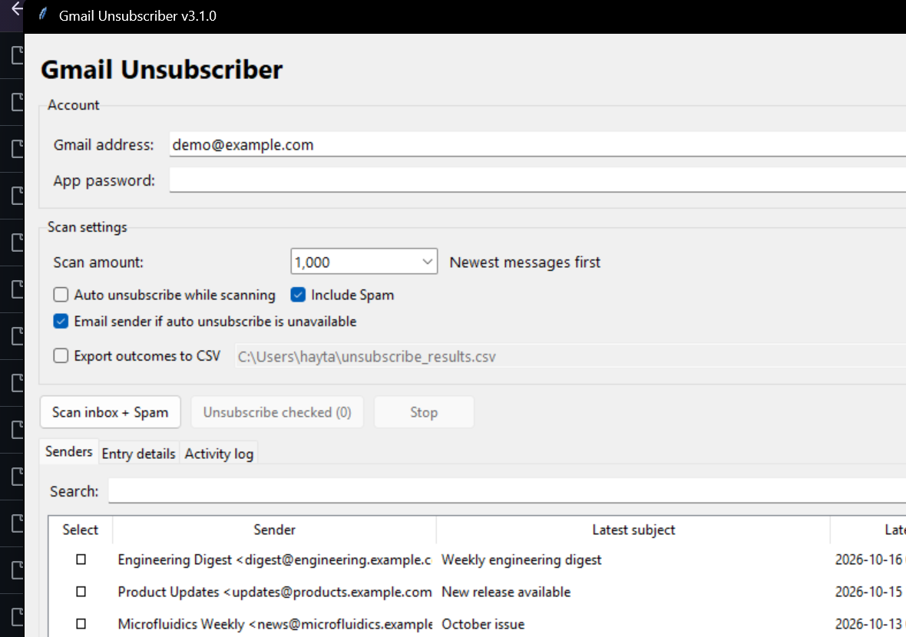
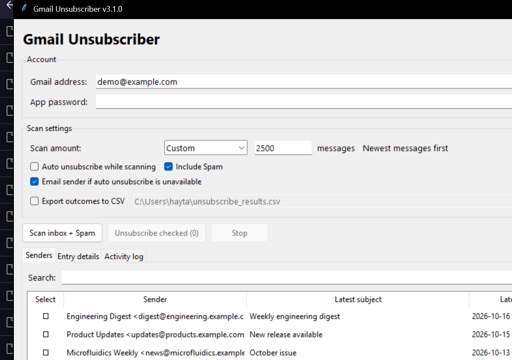
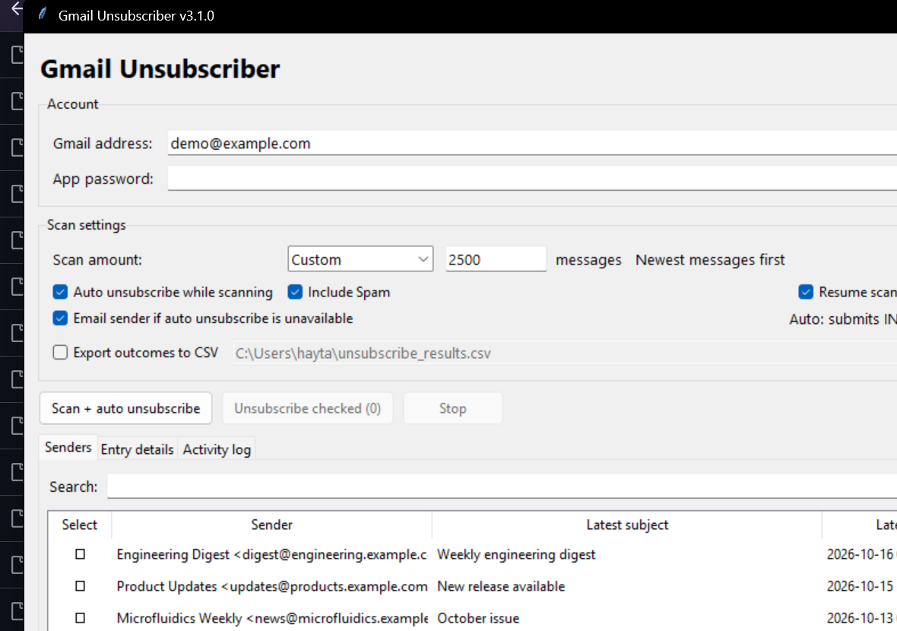
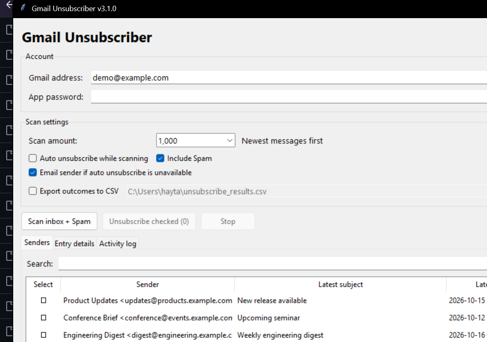
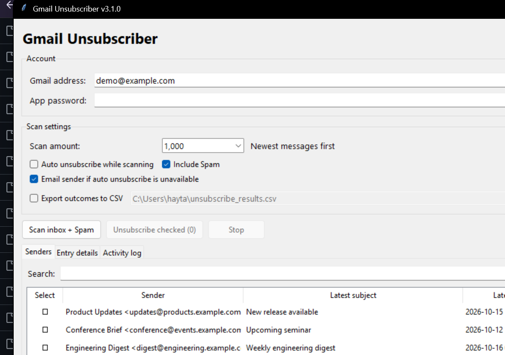

# Gmail Unsubscriber

**Version 3.1.0 | Windows and Linux | Python 3.10+**

Scan Gmail mailing lists, choose which senders to unsubscribe from, and review the results. Auto unsubscribe is available as an option. The desktop interface stays lightweight and uses the original Tkinter layout.



*Screenshots use sample email records. They are captured from the actual Tkinter application without accessing Gmail. The appearance of native controls may differ between Windows and Linux.*

<details>
<summary>More screenshots</summary>

### Scan amount and folders

Choose 250, 500, 1,000, Custom, or Entire inbox. **Include Spam** also examines the Spam mailbox. In automatic mode, Spam results are for review only.



### Auto unsubscribe

Auto unsubscribe is off by default. When enabled, valid one-click and email-based unsubscribe requests can be submitted as INBOX messages are examined.



### Search and outcome sorting

Search locally and sort by Sender, Subject, Latest email, or **Outcome**. Click the Outcome column to reverse the order and bring failures or successful submissions together.



### Scan progress and resume

The scan counts examined messages and keeps the progress bar updated. The **Resume scan** checkbox uses a local checkpoint to skip messages that were processed in a previous interrupted run with the same settings.


On completion, the bar stays full. Complete means the scan finished, not that all removal requests succeeded.



</details>

## Setup

You'll need Python 3.10 or newer with Tkinter, the dependencies in `requirements.txt`, and a Google app password. Your regular Gmail password won't work.

1. Download the source ZIP or clone the repository and keep the files together.
2. On Windows, open `Gmail Unsubscriber (Standard Mode).pyw` or use `Start Gmail Unsubscriber.cmd`.
3. Allow dependency installation if prompted. On Linux, use `python gmail_unsubscriber.py` after installing requirements.

Administrator access is not needed to scan Gmail. The standard Windows launcher avoids an unnecessary elevation request.

## Use it

Enter your Gmail address and app password. **Google app passwords** opens the account page.

**Scan amount** supports **250**, **500**, **1,000**, **Custom**, and **Entire inbox**. The last option asks for confirmation before scanning all selected folders. With **Include Spam** and a limited scan, the limit is shared between INBOX and Spam, with unused capacity taken from the other folder. Archived messages and Trash are not scanned.

**Auto unsubscribe while scanning is off by default.** Click **Scan inbox**, check the senders you want to remove, and click **Unsubscribe checked**. You may check senders while scanning, but requests are submitted only after scanning stops or finishes. Merely highlighting a row does not check its box.

With auto mode on, choose **Scan + auto unsubscribe**. Supported INBOX requests are submitted while scanning, without per-sender approval. **Spam is always scanned for review only in auto mode.** To act on a Spam sender, use scan-only mode and check it manually. Scanning never deletes, moves, or marks messages as read.

### Optional plain unsubscribe request emails

Check **Email sender if auto unsubscribe is unavailable** to permit a direct unsubscribe request from your Gmail account when supported automatic methods are not available or unsuccessful. This is separate from the auto unsubscribe setting. The app only enables this extra option for identifiable INBOX mailing-list messages with a `List-ID`, `List-Unsubscribe`, or list/bulk `Precedence` header and a usable sender address. It does not use this fallback for Spam, ordinary messages without list identification, or common no-reply addresses.

A request email asks for removal but cannot guarantee it. It may also reveal that the account is active, so **the option is off by default**. Existing `mailto:` unsubscribe instructions still take priority. Requests requiring confirmation on a webpage are not submitted as one-click operations.

### Resume an interrupted scan

Leave **Resume scan** checked to continue after stopping the program, a crash, or a restart. Progress is saved locally. On the next run, enter the same Gmail account and select the same scan amount, folders, and mode. The app restores the previous scan results, skips completed message UIDs, and processes the remaining messages. It checks mailbox UIDVALIDITY so a mailbox reset will not mix up saved UIDs and current messages.

Uncheck **Resume scan** to start a new scan. The durable request history still protects accepted or uncertain requests from being automatically resent. If a request was interrupted during delivery, its status may be **Outcome unknown** and it is not repeated automatically.

**Stop** cancels subsequent work. It cannot recall an HTTP request or email that was already sent.

## Find, sort, and select senders

Each sender gets a row showing its most recent scanned subject, date, number of mailing lists, and outcome. Searching matches sender names, addresses, subject lines, and List-IDs including earlier scanned subjects. Search and sorting are local operations, with no extra Gmail requests.

**Sort by** includes **Sender**, **Subject**, **Latest email**, and **Outcome**. Click the Outcome heading or use the direction button to group failed and successful results. The date column uses the email's `Date` header in local time. Unknown dates appear at the bottom when sorting by date.

**Check shown** selects the visible filtered rows only. **Clear checks** removes all selections. Checked senders remain selected when search or sorting hides them. Double-click a sender or use **View details** to inspect target URLs, distinct lists, and method outcomes.

## Results and limits

The app handles supported HTTPS one-click unsubscribe requests and `mailto:` addresses in the `List-Unsubscribe` header. HTTPS one-click submission requires DKIM verification. Web confirmation pages are flagged as **Manual action required** and are not opened or completed automatically.

**Request accepted** means the endpoint accepted the HTTP request. **Email submitted** means Gmail's SMTP service accepted the email. Neither proves the mailing list removed the address. **Failed** and **Blocked** indicate unsuccessful or unsafe attempts. **Outcome unknown** indicates the request might have been delivered, so it will not be automatically repeated. Different outcomes for one sender are shown as **Mixed outcomes**.

Use **Export results** for a CSV snapshot or enable automatic export. Results can include private email addresses and unsubscribe links. Do not commit exported results to GitHub.

### Local scan history

Version 3.1.0 uses a local SQLite database, separate from the application source:

| System | Location |
| --- | --- |
| Windows | `%LOCALAPPDATA%\gmail-unsubscriber\progress.sqlite3` |
| Linux | `${XDG_STATE_HOME:-~/.local/state}/gmail-unsubscriber/progress.sqlite3` |

It saves mailbox UIDs, header metadata, scan configuration, request results, and a per-account delivery ledger. It does not store your Gmail app password or email bodies. The database is **not encrypted** and may contain private unsubscribe URLs or tokens. Keep it private and never upload it to your repository.

Resuming prevents repeated scanning of checkpointed messages. Requests are reserved in the ledger before delivery to limit duplicate submissions even if the program exits suddenly. A request without a definitive response stays uncertain. Removing the database also removes this protection and should only be done intentionally with the application closed.

## Problems?

Use **Test connection** and check the Activity log. Passing connection tests only verifies network connectivity, not your Gmail credentials. Mailbox reads use bounded retry and reconnect handling. Repeated failures can stop a scan while retaining its saved progress.

For setup issues, keep all source files from the same version together and include sanitized errors when reporting a problem. Remove account addresses, passwords, tokens, and private links from reports.

## Tests

Install requirements and run:

```sh
python -m unittest discover -v
```

GUI tests require a desktop session. On Linux with Xvfb:

```sh
xvfb-run -a python -m unittest discover -v
```

To refresh these README screenshots from the running application with synthetic data, install Pillow in your development environment and run:

```sh
python -m pip install pillow
python capture_readme.py
```

The tests mock Gmail, HTTP, SMTP, and DKIM verification. Offline tests cannot confirm that a live sender will accept an unsubscribe request.

## Support

Support my work on [Ko-fi](https://ko-fi.com/haytamelbouhmidi) or [Patreon](https://www.patreon.com/c/HaytamElbouhmidi).

## License

MIT. See [LICENSE](LICENSE).
